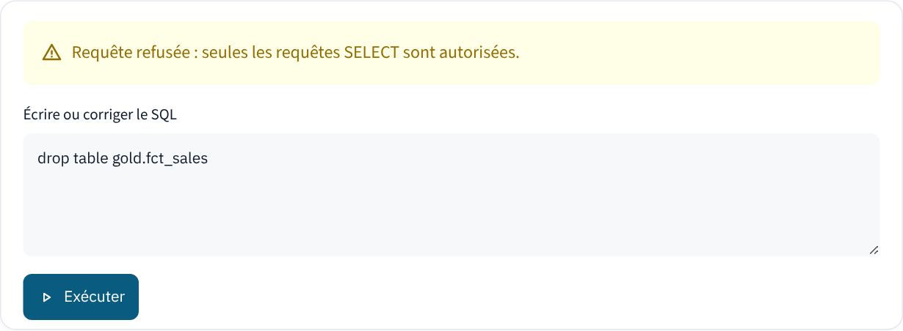

# Résumé {.unnumbered}

Ce projet met en place une plateforme de données moderne à partir de la base transactionnelle *Wide World Importers* de Microsoft. Les données de SQL Server sont extraites avec DLT et chargées dans Snowflake, où elles sont organisées en trois couches (Bronze, Silver et Gold). Les transformations sont écrites avec dbt et vérifiées par dix-huit tests de qualité ; l'ensemble est orchestré par Dagster, qui exécute la chaîne complète en un peu plus de sept minutes. Une application Streamlit permet ensuite d'interroger la couche Gold en français : la question est traduite en SQL par un modèle de langage, contrôlée, exécutée, puis restituée sous forme de tableau et de graphique. Le compte d'essai Snowflake ne donnant pas accès à la fonction Cortex `COMPLETE`, un modèle local servi par Ollama assure la génération du SQL, sans modification du reste de l'architecture.

**Mots-clés :** Modern Data Platform, architecture Médaillon, ELT, Snowflake, dbt, Dagster, Text-to-SQL.

```{=latex}
\tableofcontents
\clearpage
\pagenumbering{arabic}
\setcounter{chapter}{2}
```

# Mise en œuvre de la plateforme

## Ingestion de la couche Bronze avec DLT

La couche Bronze reçoit les données de SQL Server sans transformation métier. Nous avons retenu dix tables de la base *WideWorldImporters* : les clients, les commandes et leurs lignes, les factures et leurs lignes, les articles, ainsi que les personnes et le référentiel géographique (villes, provinces et pays). Chaque table est déclarée comme une ressource de la source DLT `wwi`, définie dans le fichier `loads.py`.

```{.python caption="Extrait de la source DLT (defs/mssql_ingestion/loads.py)" label=code-dlt}
@dlt.source(name="wwi")
def wwi_source():
    yield sql_table(
        credentials=credentials, schema="Sales", table="Customers",
        write_disposition="replace",
        excluded_columns=["DeliveryLocation"],  # type geography non géré
    )
    yield sql_table(
        credentials=credentials, schema="Sales", table="Orders",
        write_disposition="merge", primary_key="OrderID",
        incremental=dlt.sources.incremental("LastEditedWhen"),
    )
```

Deux modes de chargement coexistent. Les tables de référence, peu volumineuses, sont rechargées entièrement à chaque exécution (`write_disposition="replace"`, ligne 5). Les tables de faits sont chargées de façon incrémentale : DLT mémorise la plus grande valeur de la colonne `LastEditedWhen` déjà chargée et ne lit, à l'exécution suivante, que les lignes modifiées depuis (ligne 11). La clause `merge`, associée à la clé primaire `OrderID`, met à jour une commande déjà présente au lieu de la dupliquer. Les colonnes de type `geography` de SQL Server, que le pilote SQLAlchemy ne sait pas convertir, sont exclues explicitement (ligne 6) ; elles provoquaient auparavant un avertissement à chaque chargement.

Le choix de la destination se fait par la variable d'environnement `DLT_DESTINATION`. Le même code alimente ainsi une base DuckDB locale pendant le développement, puis le schéma `BRONZE` de Snowflake. La figure \ref{fig:dlt-run} montre l'exécution de cette étape depuis Dagster : le chargement initial des dix tables dans Snowflake a duré 4 min 33 s.

{#fig:dlt-run width=100%}

Le tableau \ref{tab:bronze} récapitule les volumes chargés dans Snowflake, relevés dans le schéma d'information de la base après exécution.

Table                      Lignes  Mode de chargement
---------------------- ----------  ----------------------
`order_lines`             231 412  incrémental (`merge`)
`invoice_lines`           228 265  incrémental (`merge`)
`orders`                   73 595  incrémental (`merge`)
`invoices`                 70 510  incrémental (`merge`)
`cities`                   37 940  complet (`replace`)
`people`                    1 111  complet (`replace`)
`customers`                   663  complet (`replace`)
`stock_items`                 227  complet (`replace`)
`countries`                   190  complet (`replace`)
`state_provinces`              53  complet (`replace`)

: Volumes chargés dans le schéma `BRONZE` de Snowflake\label{tab:bronze}

DLT normalise les identifiants : `OrderLines` devient `order_lines` et `CustomerID` devient `customer_id`. Cette conversion n'était pas documentée dans les exemples que nous avions suivis ; elle explique pourquoi nos premiers modèles dbt, écrits avec les noms d'origine de SQL Server, échouaient. Les sources dbt déclarent donc le nom logique de chaque table et son nom physique (`identifier`), ce qui préserve en outre le lien automatique entre les actifs DLT et dbt dans Dagster.

## Contrôle des requêtes générées

Une requête produite par un modèle de langage ne peut pas être exécutée telle quelle : le modèle peut ajouter une explication autour du SQL, produire plusieurs instructions ou, sur une question mal formulée, proposer une modification des données. Avant toute exécution, l'application fait donc passer chaque requête par la fonction `clean_sql` du module `warehouse.py`.

~~~~ {.python caption="Contrôle d'une requête avant exécution (presentation_app/warehouse.py)"}
FORBIDDEN = re.compile(
    r"\b(insert|update|delete|merge|drop|alter|create|truncate|grant|revoke|"
    r"copy|put|call|execute|attach|detach|install|pragma)\b",
    re.IGNORECASE,
)

def clean_sql(sql: str) -> str:
    sql = re.sub(r"```(?:sql)?", "", sql, flags=re.IGNORECASE).strip().rstrip(";").strip()
    if not re.match(r"^(select|with)\b", sql, re.IGNORECASE):
        raise QueryError("Requête refusée : seules les requêtes SELECT sont autorisées.")
    if ";" in sql:
        raise QueryError("Requête refusée : une seule instruction est autorisée.")
    if FORBIDDEN.search(re.sub(r"'[^']*'", "''", sql)):
        raise QueryError("Requête refusée : elle contient une instruction d'écriture.")
    if not re.search(r"\blimit\s+\d+\s*$", sql, re.IGNORECASE):
        sql = f"{sql}\nlimit {MAX_ROWS}"
    return sql
~~~~

Le contrôle procède en quatre temps. La requête doit d'abord commencer par `SELECT` ou `WITH` (ligne 9) ; une seconde instruction, séparée par un point-virgule, est rejetée (ligne 11). Les mots-clés d'écriture sont ensuite recherchés (ligne 13), après avoir neutralisé le contenu des chaînes de caractères : une condition comme `WHERE description = 'drop shipping'` reste ainsi acceptée. Enfin, une clause `LIMIT` est ajoutée lorsqu'elle manque (lignes 15 et 16), ce qui borne le volume renvoyé à mille lignes. Ce filtre ne remplace pas les droits de la base : en production, l'application devrait se connecter avec un rôle Snowflake limité à la lecture du schéma `GOLD`. Il évite néanmoins qu'une erreur du modèle atteigne l'entrepôt, comme le montre la figure \ref{fig:refus}.

{#fig:refus width=80%}
